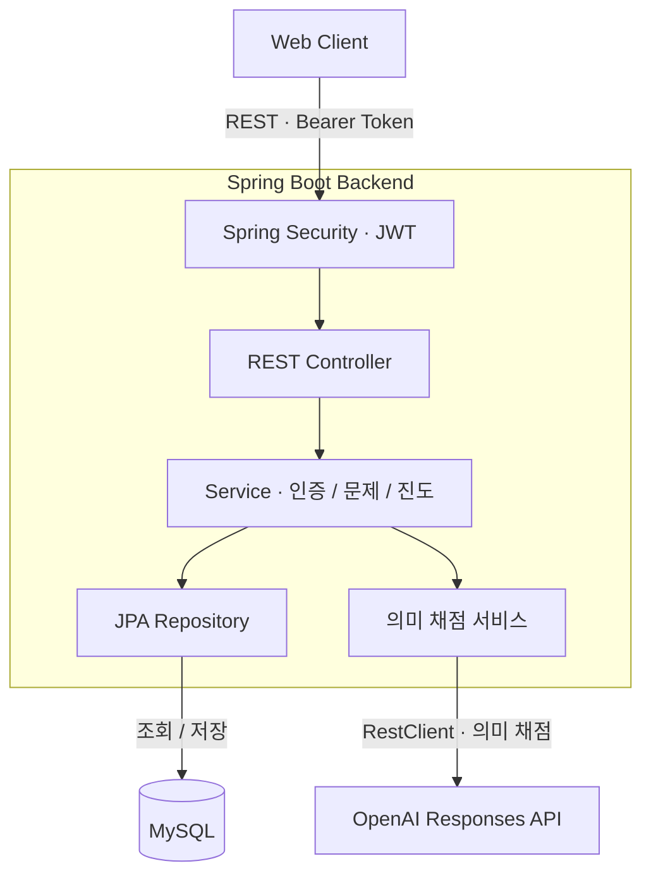
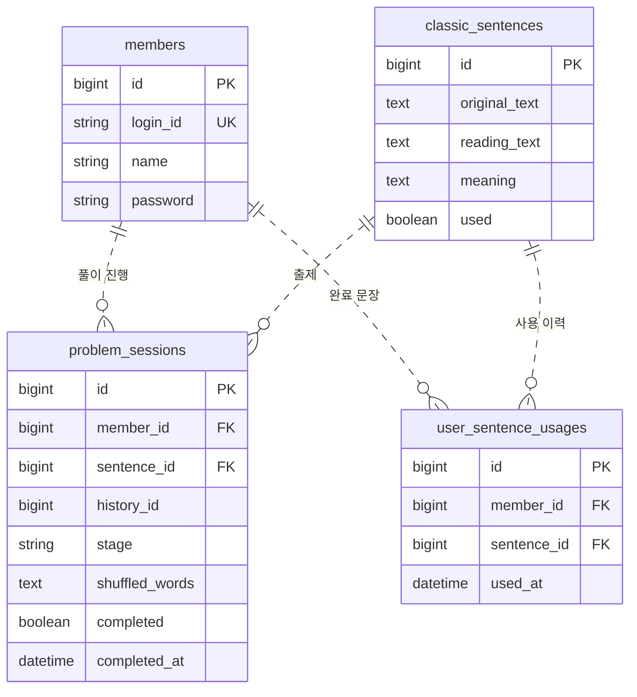
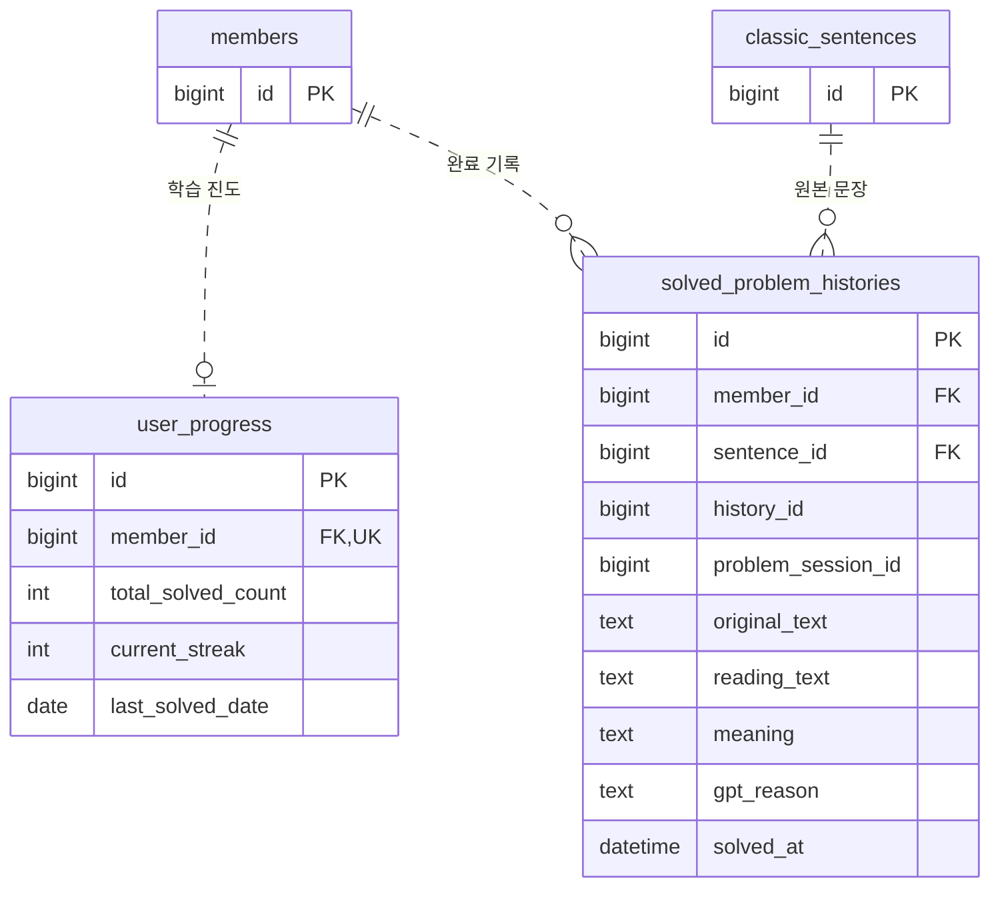

# 선비타이핑 | Backend

고전 문장의 뜻을 순서 맞추기와 타이핑으로 익히는 웹 학습 서비스

> 로고 사진

사용자는 **단어 순서 맞추기 → 따라 쓰기 → 뜻을 보지 않고 쓰기** 순서로 문제를 풉니다. 완료한 문제는 다시 복습할 수 있고, 누적 풀이 수에 따른 등급과 연속 학습일로 진행 상황을 확인합니다.

| 항목 | 내용 |
| --- | --- |
| 담당 | **박찬우 · 백엔드 개발** |
| 팀 구성 | 디자인 1명 · 프론트엔드 1명 · 백엔드 1명 |
| 참여 | [2026년 영주시 공공데이터 활용 창업경진대회](https://linkareer.com/activity/308647) · 참여, 미수상 |
| 주요 기술 | Java 17 · Spring Boot 4.0.5 · Spring Security · Spring Data JPA · MySQL |
| 외부 연동 | OpenAI Responses API · Spring RestClient |

> 서비스 소개 사진

[API와 실행 방법](docs/backend-guide.md) · [빌드 설정](build.gradle)

## 백엔드 담당 역할

회원 인증부터 문제 풀이, 완료 기록 저장까지 서버 기능을 구현했습니다.

| 영역 | 구현 내용 |
| --- | --- |
| 인증 | BCrypt 비밀번호 해싱, Access Token 발급·검증, Refresh Token 발급, 로그인한 회원 식별 |
| 문제 풀이 | 회원별 출제, 진행 중인 문제 재사용, 풀이 단계와 소유권 검증 |
| 기록·진도 | 완료 당시의 문장·답안 저장, 누적 풀이 수·연속 학습일·등급 계산 |
| 의미 채점 | OpenAI API 연동, JSON Schema로 채점 결과 형식 지정, 결과와 설명 저장 |

## 아키텍처

단일 Spring Boot 애플리케이션에서 인증·문제·학습 기록 기능을 나눴습니다. 요청은 Spring Security를 거쳐 Controller와 Service로 전달되며, JPA Repository를 통해 MySQL에 저장됩니다. 마지막 쓰기 단계에서는 OpenAI API로 의미를 채점합니다. 위 그림은 소스 기준의 애플리케이션 구성입니다.

## 핵심 설계

### 1. 사용자마다 이어지는 풀이 번호

문제 세션의 PK는 전체 사용자 사이에서 증가하므로, 개인의 풀이 순번으로 사용하기 어렵습니다. 답안 제출에 쓰는 `problemId`와 사용자별 풀이 순번인 `historyId`를 분리했습니다.

3번 문제까지 완료한 사용자가 2번을 요청하면 완료 기록을 반환하고, 4번을 요청하면 진행 중인 세션을 재사용하거나 새 문제를 만듭니다. 5번처럼 순서를 건너뛴 요청은 400으로 거절합니다. 섞인 단어 순서도 세션에 저장해 같은 문제를 다시 열었을 때 유지합니다.

출제 시에는 **해당 회원이 완료한 문장**을 제외합니다. 회원별 문장 사용 이력을 별도 테이블에 두어 같은 문장을 여러 사용자가 각자 학습할 수 있도록 했습니다.

코드: [ProblemService](src/main/java/youngju/seonbimind/classic/problem/service/ProblemService.java) · [ClassicSentenceRepository](src/main/java/youngju/seonbimind/classic/sentence/repository/ClassicSentenceRepository.java)

### 2. 서버에서 검증하는 단계 전환과 풀이 소유권

풀이 상태를 `ORDER → COPY_TYPING → BLIND_TYPING → COMPLETED`로 관리합니다. 정답이면 다음 단계로 이동하고, 오답이면 현재 단계에 머무릅니다.

답안을 제출할 때는 문제 ID와 인증된 회원을 함께 조건으로 조회합니다. 다른 회원의 문제이거나 존재하지 않으면 404, 현재 단계와 맞지 않거나 이미 완료된 문제라면 409를 반환합니다. 서버에 저장된 상태를 기준으로 요청 순서를 검증합니다.

코드: [ProblemService.getMyProblemSession / validateStage](src/main/java/youngju/seonbimind/classic/problem/service/ProblemService.java) · [ProblemSession](src/main/java/youngju/seonbimind/classic/problem/entity/ProblemSession.java)

### 3. 완료 기록 보존과 진도 갱신

복습할 때는 문제를 풀었던 당시의 내용을 보여줄 수 있어야 합니다. 완료 시점의 원문·독음·뜻·단어 순서·답안·채점 설명을 `solved_problem_histories`에 복사해 저장했습니다. 원본 문장의 내용이 바뀌어도 복습 응답은 저장된 기록을 사용합니다.

최종 정답 처리에서는 세션 완료, 회원별 문장 사용 이력, 진도 갱신, 완료 기록 저장을 같은 DB 트랜잭션에서 처리합니다. 세션과 완료 기록에 각각 `(member_id, history_id)` 유니크 제약을 두었습니다. 동시 제출까지 보장하려면 별도의 동시성 검증과 처리가 필요합니다.

연속 학습일은 서울 시간의 날짜를 기준으로 계산합니다. 같은 날 여러 문제를 풀어도 하루만 증가하며, 누적 풀이 수는 완료한 문제마다 증가합니다.

코드: [ProgressService](src/main/java/youngju/seonbimind/classic/progress/service/ProgressService.java) · [SolvedProblemHistory](src/main/java/youngju/seonbimind/classic/progress/entity/SolvedProblemHistory.java) · [UserProgress](src/main/java/youngju/seonbimind/classic/progress/entity/UserProgress.java)

### 4. 단계에 맞춘 채점 방식

순서 맞추기와 따라 쓰기는 공백을 정규화한 문자열로 채점합니다. 뜻을 보지 않고 쓰는 단계에서는 표현이 달라도 의미가 같을 수 있어 OpenAI Responses API를 사용했습니다.

JSON Schema로 정오답 `correct`와 설명 `reason`을 요청하고, 응답을 DTO로 변환해 완료 여부를 결정합니다. 채점 설명은 훈장님 말투로 요청하며, 답안과 함께 저장합니다.

현재 외부 호출은 동기 방식으로 DB 트랜잭션 안에서 수행됩니다. DB 변경을 롤백해도 이미 수행한 외부 API 호출은 취소되지 않으므로, 호출 시간 제한과 트랜잭션 경계 개선을 후속 과제로 두었습니다.

코드: [GptMeaningEvaluationService](src/main/java/youngju/seonbimind/classic/gpt/service/GptMeaningEvaluationService.java) · [MeaningEvaluationResult](src/main/java/youngju/seonbimind/classic/gpt/dto/MeaningEvaluationResult.java)

## 데이터 모델

6개 테이블을 문제 풀이와 학습 기록으로 나누어 표시했습니다. 두 그림의 `members`와 `classic_sentences`는 같은 테이블입니다.

### 문제 풀이

### 학습 기록

ERD는 JPA 매핑의 주요 컬럼과 관계를 표시합니다. 복합 유니크 제약과 NULL 허용 여부는 아래와 같습니다.

- `problem_sessions`와 `solved_problem_histories`: 각각 `(member_id, history_id)` 복합 유니크 제약을 둡니다.
- `user_sentence_usages`: `(member_id, sentence_id)` 유니크 제약으로 회원별 완료 문장을 관리합니다.
- `user_progress`: 회원당 최대 1행이며 첫 문제 완료 시 생성합니다.
- `solved_problem_histories.problem_session_id`: 일반 ID 컬럼으로, 세션 테이블과의 FK 관계는 선언되어 있지 않습니다.
- 세션과 완료 기록의 `history_id`는 NULL을 허용하며, 서비스에서 기존 기록의 누락 번호를 보정합니다.

## 검증과 개선 과제

공개 코드 [2f1f2a5](https://github.com/ParkChanWoo0321/Seonbi-Typing/commit/2f1f2a56c87b38af150348e1b020a03483337091)에서 소스·테스트 소스 컴파일과 실행 JAR 생성을 확인했습니다. 현재 테스트 코드는 컨텍스트 로딩 테스트 1개입니다. 검증 범위는 컴파일과 JAR 생성이며, 테스트 실행과 실제 DB·OpenAI 연동 검증은 제외했습니다.

| 개선 항목 | 다음 작업 |
| --- | --- |
| 동시 요청 | 문제 시작·최종 답안 중복 제출 테스트, 잠금 또는 멱등성 처리 검토 |
| 인증 | Refresh Token 재발급·폐기, 로그아웃 정책과 JWT 시간 클레임 정비 |
| 외부 채점 | 호출 시간 제한, 오류 응답 정리, DB 트랜잭션과 호출 범위 분리 |
| 조회·테스트 | 기록 페이지네이션, 출제 쿼리 개선, 단계·권한·날짜 경계 테스트 추가 |

상세 API, 실행 환경, 현재 제약은 [백엔드 개발 가이드](docs/backend-guide.md)에 정리했습니다. 아키텍처와 ERD는 이 README의 Mermaid 코드로 관리합니다.
